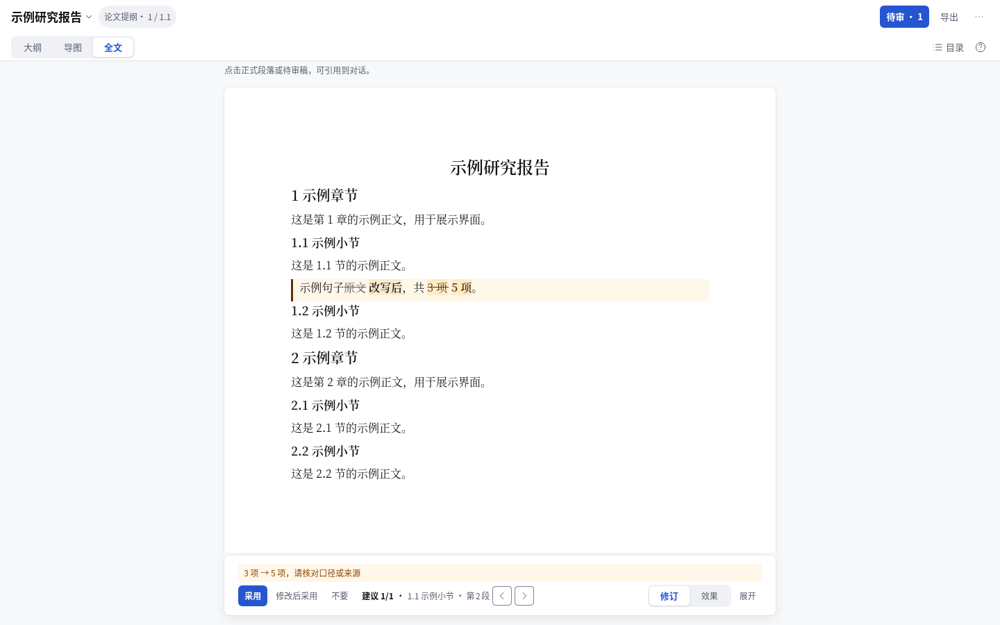
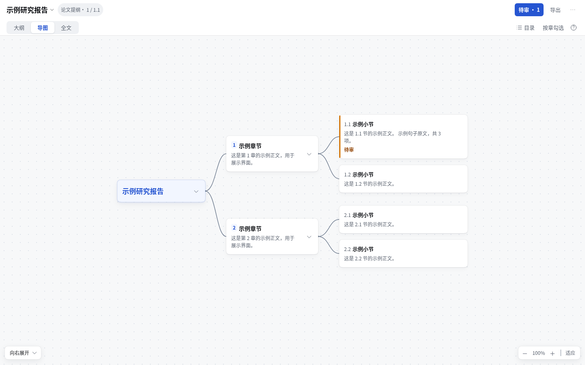
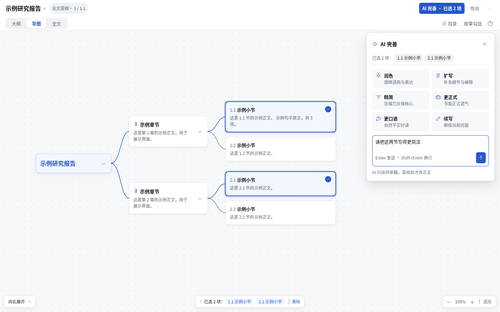
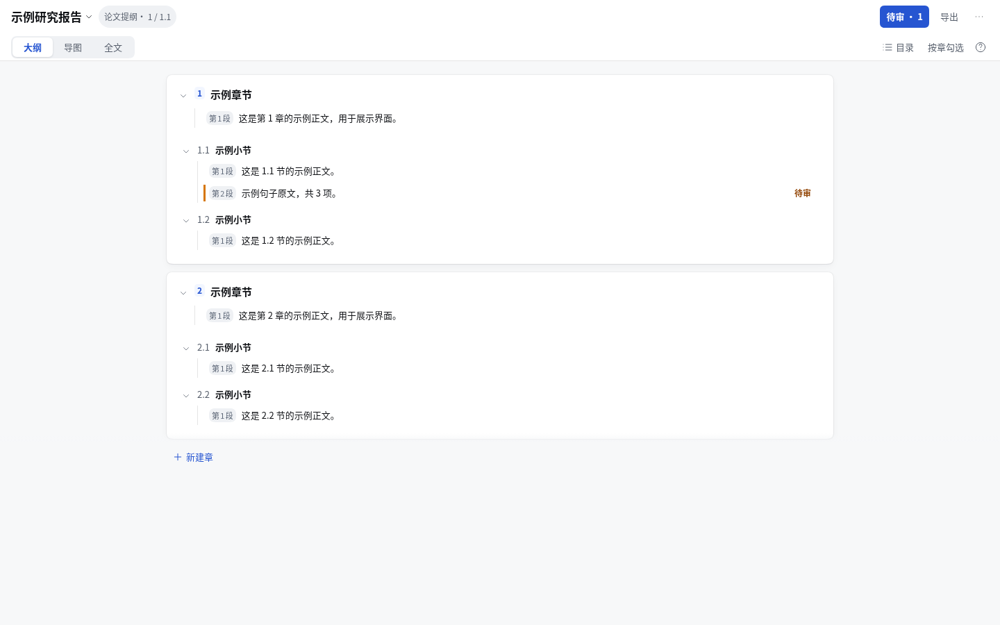

# Mindwrite · 导图写作

[简体中文（主页）](README.md) | **English** · [Quick Install](#quick-install) · [Privacy & Limitations](#privacy--known-limitations)

[](https://github.com/oOMickey/dsh-mindwrite/releases/latest)

[](LICENSE)

Write long-form documents in **DeepSeek Harness (DSH)**: theses and papers, research reports, project proposals, and work summaries. Organize chapters in a mind map or outline, review AI edits inline in full text, and export clean Word or Markdown files.

<sub>Independent community plugin compatible with DeepSeek Harness (DSH). Not affiliated with, authorized, or endorsed by DeepSeek.</sub>



## Quick Install

- **Host compatibility**: DSH `>=0.2.2-rc.3 <0.3.0` (verified on Linux Web `0.2.2-rc.3`; Windows x64 Desktop is a compatibility target).
- **Runtime**: DSH Desktop bundles its own runtime; Web/CLI requires Node.js `>=24.9.0`. Word import/export dependencies are bundled.

> [!IMPORTANT]
> Mindwrite is distributed **only** through this repository's [GitHub Releases](https://github.com/oOMickey/dsh-mindwrite/releases). **The npm package of the same name is not published by us.**

1. In DSH, open **Plugins → Add Plugin** and paste this `.tgz` URL into **Package name or URL**:

```text
https://github.com/oOMickey/dsh-mindwrite/releases/download/v0.8.5/dsh-mindwrite-0.8.5.tgz
```

2. Click **Install**, enable the plugin, and **reload** when prompted.
3. Open a session linked to a workspace folder, launch **Mindwrite** in the **right sidebar**, and set session permission to **workspace writes** before saving or exporting.

> Paste the URL ending in `.tgz`, not the repository URL. The repository contains source only, so DSH would attempt to build it on install and may fail.

<details>
<summary>Offline install (if DSH cannot reach GitHub)</summary>

1. Download [`dsh-mindwrite-0.8.5.tgz`](https://github.com/oOMickey/dsh-mindwrite/releases/tag/v0.8.5) in your browser and **do not extract it**.
2. In **Plugins → Add Plugin**, paste the **full absolute path** to the `.tgz` file (for example `D:\Downloads\dsh-mindwrite-0.8.5.tgz`) and remove any quotation marks at either end.
3. Click **Install**, enable the plugin, and reload.

</details>

## Key Features

- **Review AI edits in context**: Switch between **Redlines** (insertions, deletions, and highlighted numbers, deadlines, and obligation terms) and **Preview** (clean accepted text). Click a pending passage or **Continue revising** to iterate on the same suggestion with AI. Accept, edit and accept, or discard item by item—exports contain only accepted text.
- **Structure with map, outline, and full text**: In an empty draft, let AI build an outline (one level at a time by default), write the first chapter yourself, paste an outline, or import a Word or Markdown file. Wide mind-map cards display each chapter's body summary; double-click nodes to edit; select a chapter and press `Ctrl+V` to append text or create subsections with one-click undo.
- **Six document types & four numbering schemes**: Supports thesis outlines, reports, plans, speeches/articles, notices, and policies, with decimal paths (`1.1`), Chinese heading levels, chapter-and-article numbering, or unnumbered headings. Preview numbering and layout from the title badge before switching.
- **Checks & delivery**: Quote a heading or paragraph into DSH chat for targeted rewrites or read-only Q&A. Check for empty clauses, numbering issues, and dangling references before exporting to Word (`.docx`), a three-column comparison Word table, or Markdown.

### New in v0.8.5

- To **box-select cards** on a wide map, drag from blank space with the left mouse button until the cards you want are fully enclosed. Hold Space and drag, or drag with the right mouse button, to pan. In a narrow pane or with a finger or pen, drag blank space to pan.
- Open **Select by chapter**, expand a chapter, and tick the sections you want to revise together. You can pick sections from different chapters.
- Before sending, check the section numbers and titles in the **Selected N** list at the bottom, then open **AI improve** at the top and type your instructions. To revise one section, right-click it and choose **Use my instructions… (this section only)**. Closing the menu keeps your original selection.
- Import recognizes typed heading numbers in Word and Markdown, as well as automatic list numbers in Word. The **import report** records the original numbers and explains the document type and numbering choices separately. Click a warning about a gap or duplicate to jump to that passage.
- **Papers and research reports** have their own AI writing instructions. For papers, AI is asked to retain citations and distinguish hypotheses from findings. For reports, it is asked to identify the sample, units, and sources. Review prompts flag changes to citations, figures, and units so you can check them against the original material.
- The map, outline, full text, and review bar use **soft cards** in both light and dark themes.

| Mind map and outline | Cross-chapter selection and starting a draft |
| --- | --- |
|  |  |
|  |  |

For the complete step-by-step workflow, numbering reference, and backup recovery instructions, see the [Chinese guide (中文主页)](README.md).

## Privacy & Known Limitations

> [!NOTE]
> **Privacy & model scope**: Mindwrite has **no telemetry** and does not report data anywhere. DSH sends all AI requests. A selection limits which blocks may be modified, while the model configured in DSH may still receive the full map including body text.

- **Concurrent saves**: On DSH `0.2.2-rc.3`, a brief window remains between the final version check and file replacement. An external editor saving the same file during that window can be overwritten, and even a successful read-back may not warn. Avoid saving the same document from two editors simultaneously.
- **Word import & pagination**: Import treats the source as accepting all tracked changes. Simple tables convert to `Column: value` lines; raw XML for complex tables is stored in writing notes. Images, footnotes, comments, and complex table layouts are not restored—keep your original Word file. Exported pagination depends on local fonts; Windows font rendering and line breaks are still being verified on physical devices.
- On Windows, hands-on checks are still in progress for mouse box selection and panning, and for the Chinese input method's candidate window.
- **Local backups**: Uncommitted drafts recover on reopen, and verified backups are written to `.mindwrite/backups/` before the first overwrite or adoption. When moving a draft, keep its filename and copy `.mindwrite/` alongside it. Recovery details are in [CHANGELOG.md](https://github.com/oOMickey/dsh-mindwrite/blob/main/CHANGELOG.md).

## Roadmap & Feedback

- We plan to let you switch interface styles in the next release.
- **Feedback welcome**: Let us know which numbered headings fail on import, how the review modes and quote/Q&A actions feel, and any layout differences across Windows x64 Desktop, macOS, Web, Word, or WPS.
- **Filing an issue**: Include your DSH version, Mindwrite version, OS, reproduction steps, expected vs. actual results, and redacted screenshots. Reproduce with placeholder text (such as `Sample Document` and `Sample body text`) and remove real document text, usernames, file paths, and credentials before posting. → [Open an issue](https://github.com/oOMickey/dsh-mindwrite/issues/new/choose)

## Build from Source

<details>
<summary>Show source build commands (Node.js 24 & npm 11)</summary>

Checked with Node.js `24.22.1` and npm `11.19.1` at the repository root:

```sh
npm ci
npm run typecheck
npm run build
npm pack
```

Automated tests are run locally by the maintainer and are not included in the public repository. For testing the generated `.tgz` in an isolated DSH profile, see [CONTRIBUTING.md](https://github.com/oOMickey/dsh-mindwrite/blob/main/CONTRIBUTING.md).

</details>

## Changelog & License

- Release history and backup recovery procedures: [CHANGELOG.md](https://github.com/oOMickey/dsh-mindwrite/blob/main/CHANGELOG.md) · [GitHub Releases](https://github.com/oOMickey/dsh-mindwrite/releases)
- Licensed under [MIT](LICENSE). Bundled dependency notices: [THIRD-PARTY-NOTICES.md](THIRD-PARTY-NOTICES.md).
