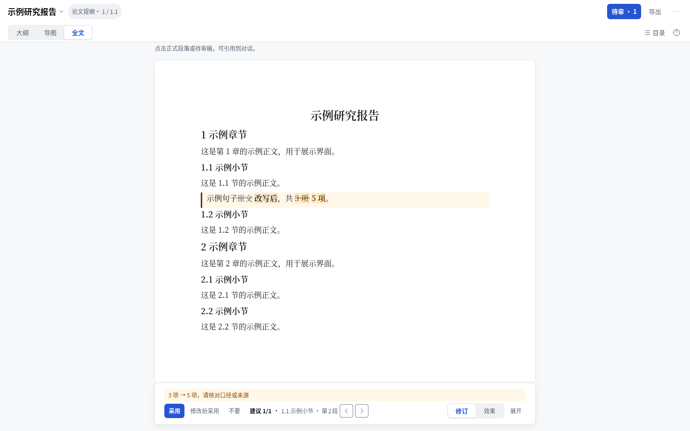
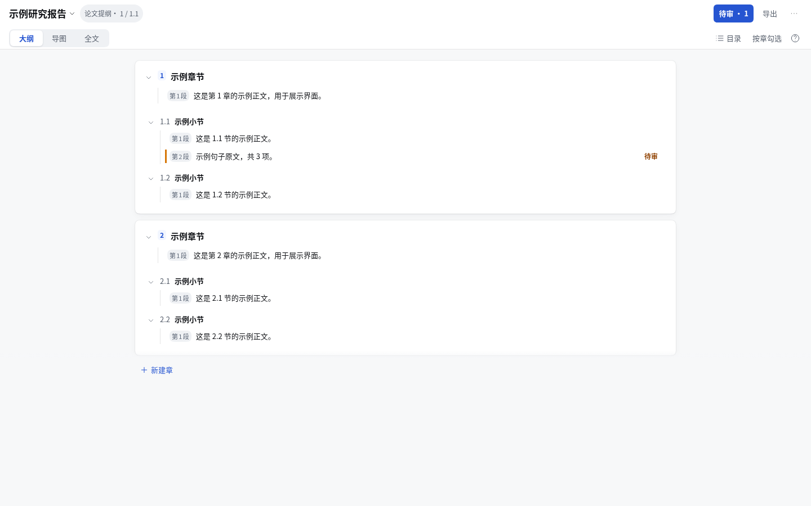

# 导图写作 · Mindwrite

**简体中文** | [English](README.en.md) · [快速安装](#快速安装) · [隐私与限制](#隐私说明与已知限制)

[](https://github.com/oOMickey/dsh-mindwrite/releases/latest)

[](LICENSE)

在 **DeepSeek Harness（DSH）** 里写长文本：论文、研究报告、项目方案、工作总结都适用。先用导图和大纲搭好章节，再把 AI 的改稿放回全文里逐句核对，由你决定哪些内容进入正式稿，最后导出 Word 或 Markdown。

<sub>独立开源插件，基于 DeepSeek Harness（DSH）插件机制构建，与深度求索（DeepSeek）无隶属、合作或官方背书关系。</sub>



## 快速安装

- **适用版本**：要求 DSH `>=0.2.2-rc.3 <0.3.0`。已在 Linux Web 版 `0.2.2-rc.3` 验证，兼容目标为 Windows x64 Desktop。
- **运行环境**：DSH Desktop 自带运行环境，无需另装；Web/CLI 版需要 Node.js `>=24.9.0`。Word 导入和导出组件已随安装包提供。

> [!IMPORTANT]
> 本插件**只通过本仓库的 [GitHub Releases](https://github.com/oOMickey/dsh-mindwrite/releases) 分发**，**npm 上同名的包不是我们发布的**，请勿从 npm 安装。

### 第一步：复制安装包地址并安装

1. 打开 DSH，进入「**插件 → 添加插件**」。
2. 在「**包名或地址**」输入框里，粘贴下面这行地址：

```text
https://github.com/oOMickey/dsh-mindwrite/releases/download/v0.8.5/dsh-mindwrite-0.8.5.tgz
```

3. 点击「**安装**」，装好后点「**启用**」，再按提示「**重新加载**」。

> 请粘贴以 `.tgz` 结尾的下载地址，不要粘贴 GitHub 仓库主页地址。仓库里只有源码，直接粘贴会导致 DSH 现场构建，容易失败。

### 第二步：在会话里打开

打开一个**已绑定工作区文件夹**的会话，在**右侧边栏**找到「**导图写作**」。保存和导出前，请把会话权限设为「**工作区内修改**」。

### 连不上 GitHub？用离线安装包

1. 用浏览器打开 [v0.8.5 发布页](https://github.com/oOMickey/dsh-mindwrite/releases/tag/v0.8.5)，下载 `dsh-mindwrite-0.8.5.tgz`。**不要解压这个压缩包。**
2. 记下它的完整保存路径，例如 `D:\Downloads\dsh-mindwrite-0.8.5.tgz`。
3. 在 DSH「**插件 → 添加插件**」的「**包名或地址**」里粘贴这个完整路径。
   - 提示：Windows 右键「复制文件地址」会自动带上首尾双引号，**粘贴后请删掉前后的双引号**。
4. 点击「**安装**」、启用并重新加载。

## 六步上手：从旧稿到正式稿

1. **建稿并选文种**：空稿有「让 AI 起草骨架」「自己写第一章」「粘贴提纲」「导入旧稿」四个入口。AI 默认每次展开一层，可按需要调整。导入旧稿可用 Word 或 Markdown 文件。点文稿名旁的类型标签，先预览编号和版式再决定是否切换。
2. **整理章节**：窄栏可在大纲里按章展开阅读段落。宽屏导图的章卡片会显示本章正文摘要，双击就能改标题和正文。全文视图把章导语放在子节之前。
3. **粘贴材料到章节**：在大纲或导图选章后按 `Ctrl+V`，纯文本接到章末，带标题和层级的材料可建成新小节。在全文点中一个正式段落后粘贴，会插在该段后面。底部提示条可切换放法，也能一次撤销；目标已有待审建议时会先提醒。
4. **让 AI 改一段**：在全文点标题引用整个小节，点自然段只引用这一段，再点一次取消引用。在对话里写下要求并发送即可；只想参考不改稿时，点「就此提问」插入只读参考卡。也可选中节点后点「AI 完善」。
5. **在全文里审稿**：「修订」视图用删除线和下划线标出增删，数字、金额、期限和义务词变化会高亮；「效果」视图预览采用后的读法。底部按「建议 N/M」翻条，逐条选「采用」「修改后采用」或「不要」，采用后可撤销。还要继续改时，点待审段落或抽屉里的「继续改」，把卡片和新要求发给 AI 即可（有手改稿时可选它作起点）。
6. **检查并导出正式稿**：导出前先检查空条、编号和悬空引用，有待审建议时会提醒。**导出只含已采用的正式正文**，支持 Word、Markdown，以及「更多 → 修订对照表」生成的三列对照 Word（原文、新文、修改说明）。

### v0.8.5 新增

- 要在宽屏导图里**框选卡片**，从空白处按住鼠标左键拖动，把想选的卡片完整框住。要平移，按住空格拖动或用鼠标右键拖动。在窄栏里或使用触屏、触笔时，直接拖动空白处即可平移。
- 打开「**按章勾选**」，展开章名，勾上要一起改的小节。不同章的小节也可以一起选。
- 发送前，先在底栏「**已选 N 项**」核对编号和标题，再到顶部「AI 完善」直接写要求。只想改一节时，右键该节选「按我的要求改…（仅此节）」，关掉菜单后仍保留原来的多选。
- 导入 Word 或 Markdown 时，会识别手打的标题编号，也能读出 Word 的自动列表编号。**导入报告**会记录原号，分别说明文种和编号的判断依据。点跳号或重号提示，就能回到相应位置。
- **论文和研究报告**各有 AI 写作指引。论文要求保留引文、区分假设与发现，研究报告要求交代样本、单位和来源。审稿时会提醒你对照原始材料，核对改动的引文、数字和单位。
- 导图、大纲、全文和审阅栏都采用**柔和卡片**，支持浅色和深色主题。

## 界面预览

| 宽屏导图与大纲视图 | 跨章选区与空稿起步 |
| --- | --- |
|  |  |
|  |  |

## 六种文稿类型与四种编号

文稿类型和编号方式会随稿保存，也可以分开调整。导出 Word 时，可在普通文档版式（常规页边距、1.5 倍行距）与公文版式之间切换。

| 文稿类型 | 默认编号样式 | 占位示例 |
| --- | --- | --- |
| 论文提纲 | 数字路径 | 1 / 1.1 / 1.1.1 |
| 报告 / 总结 | 中文层级 | 一、示例标题 /（一）/ 1. /（1） |
| 方案计划 | 中文层级 | 一、示例标题 /（一）/ 1. /（1） |
| 讲话稿 / 普通文章 | 不编号 | 示例章节 / 这是示例正文 |
| 通知 | 中文层级 | 一、示例标题 /（一）/ 1. /（1） |
| 制度 / 管理办法 | 章条编号 | 第一章 示例章节 / 第一条 |

## 隐私说明与已知限制

> [!NOTE]
> **隐私与模型可见范围**：导图写作插件自身**没有遥测**，不会向外上报数据；AI 请求由 DSH 发出。选区只限定允许改写的块，但 DSH 配置的模型仍可能读到整份导图及正文。

- **并发保存**：DSH `0.2.2-rc.3` 在最后一次版本检查与最终替换文件之间仍存在极短窗口。如果另一款软件同时保存同一份文稿，外部改动可能丢失；即便写后校验通过，也可能没有告警。请不要在两个编辑器里同时保存同一份文稿。
- **Word 导入范围**：导入时会按「接受原稿全部修订」处理。简单表格会按行转成「列名：值」；复杂表格的原始数据会保存在写作说明里。图片、脚注、批注和复杂表格排版不会还原，**请务必保留原始 Word 文件**。
- **Word 导出排版**：在 Word 和 WPS 里的实际分页取决于本机字体。Windows 下的字体和换行效果仍在实机核对中，有固定格式要求时（如学校或单位模板），可在 Word 或 WPS 里套用模板微调。
- Windows 上鼠标框选、平移的手感，以及中文输入法的选词窗口，仍在实机核对中。

## 备份与恢复

- 重新打开文稿时，可恢复本地未提交的草稿。
- 首次覆盖已有主稿或建议文件前，插件会在工作区的 `.mindwrite/backups/` 目录保存并核验副本；首次采用建议前也会保留主稿与待审队列的配对备份。
- 写后校验失败时，界面会提示本次编辑恢复副本的位置。
- **复制或迁移文稿时**：请保留原文件名，并把同工作区里的 `.mindwrite/` 文件夹一起复制，保持相对位置不变，以免丢失待审建议和备份。

<details>
<summary>按备份回执恢复正文和待审建议（需要手工恢复时展开）</summary>

1. 关闭正在写入的会话，先复制一份当前工作区留底。
2. 用主稿回执里的文件标识（`fileKey`）和 `SHA-256`，在 `.mindwrite/backups/` 中找到首次覆盖前的副本，核对摘要后复制回原文稿路径。
3. 如需恢复到首次采用建议前的状态，请按回执里的配对记录，同时还原主稿和对应的待审建议队列。
4. 详细操作步骤与不同版本的回执命名说明，见 [版本记录与恢复说明](https://github.com/oOMickey/dsh-mindwrite/blob/main/CHANGELOG.md)。

</details>

## 常见问题

**1. 粘贴地址后安装失败怎么办？**
先确认粘贴的是以 `.tgz` 结尾的压缩包地址，而不是 GitHub 仓库主页地址。如果网络连不上 GitHub，请改用上文的「离线安装包」步骤；在 Windows 下粘贴本地路径时，记得去掉首尾双引号。

**2. 装好后找不到入口，或者保存不了？**
请确认当前会话已经绑定了工作区文件夹，然后在界面**右侧边栏**打开「导图写作」。保存和导出前，需要将当前会话权限设为「工作区内修改」。

**3. 导出 Word 需要另外安装依赖吗？**
不需要，Word 导入导出组件已经打包在安装包里。如果导出后的分页与你要用的模板略有差异，在 Word 或 WPS 里直接套用模板即可。

**4. 想重装或换回其他已公开版本怎么操作？**
先关闭正在写入的会话，备份文稿和整个 `.mindwrite/` 文件夹。随后在 DSH「插件」页移除当前插件，从 Releases 下载目标版本的 `.tgz` 安装包，按离线安装步骤重新安装、启用并重新加载即可。

## 后续计划与反馈

- 下一版计划支持切换界面风格。
- **欢迎反馈以下体验**：
  - 你常写哪类文稿，还需要哪些编号层级、页眉页脚或导出版式？
  - 导入旧 Word 时，哪些带编号标题、列表或引用识别不准？
  - 两种审稿预览，以及对话引用、只读提问和「AI 完善」，哪一处容易混淆？
  - 在 Windows x64 Desktop、macOS 或 Web 上是否顺手？Word 与 WPS 的排版差异有哪些？
- **提交问题前请先脱敏**：请附上 DSH 版本、插件版本、操作系统、操作步骤、预期与实际结果及脱敏截图。**请用「示例文稿」「第一章 示例章节」「这是示例正文」这类占位文字复现**，上传前遮住真实文稿内容、用户名、电脑路径和凭据。→ [提交缺陷或建议](https://github.com/oOMickey/dsh-mindwrite/issues/new/choose)

## 从源码构建（开发者）

<details>
<summary>展开源码构建命令（Node.js 24 / npm 11）</summary>

在仓库根目录使用 Node.js 24（至少 `24.9.0`）和 npm 11。本版在 Node.js `24.22.1` 与 npm `11.19.1` 环境核验：

```sh
npm ci
npm run typecheck
npm run build
npm pack
```

自动化测试在维护者本地运行，公开仓库不包含测试目录。打包后在隔离的 DSH 配置中试装的方法，见 [贡献指南](https://github.com/oOMickey/dsh-mindwrite/blob/main/CONTRIBUTING.md)。

</details>

## 版本记录与许可证

- 更新历史与备份恢复指引：[CHANGELOG.md](https://github.com/oOMickey/dsh-mindwrite/blob/main/CHANGELOG.md) · [GitHub Releases](https://github.com/oOMickey/dsh-mindwrite/releases)
- 本插件采用 [MIT 许可证](LICENSE)，随包第三方开源声明见 [THIRD-PARTY-NOTICES.md](THIRD-PARTY-NOTICES.md)。
